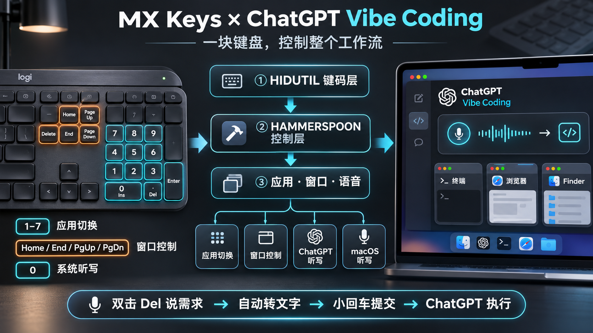

# MX Keys Vibe Console

把 Logitech MX Keys 的数字小键盘改造成 macOS 上的 ChatGPT Vibe Coding 控制台。

[下载最新安装包](https://github.com/rainleenet/mxkeys-vibe-console/releases/latest)



## 功能

| 按键 | 功能 |
|---|---|
| 小键盘 1 | ChatGPT |
| 小键盘 2 | Finder |
| 小键盘 3 | 微信 |
| 小键盘 4 | Chrome |
| 小键盘 5 | Telegram |
| 小键盘 6 | Terminal |
| 小键盘 7 | UU Remote |
| 小键盘 `./Del` 双击 | 开始/停止 ChatGPT 听写 |
| 小键盘 `0/Ins` 双击 | 开始/停止 macOS 系统听写 |
| 小键盘 Enter | 提交 ChatGPT 当前输入 |
| Home | 最大化当前窗口 |
| Page Up | 恢复上一次窗口状态 |
| Delete | 左半屏 |
| End | 最小化 |
| Page Down | 右半屏 |

方向键保持原功能。

## 技术架构

```text
MX Keys 实体按键
        ↓
hidutil：Home / Page Up / Delete / End / Page Down → F14–F18
        ↓
Hammerspoon：双击判断、应用切换、窗口控制、发送官方听写快捷键
        ↓
ChatGPT / macOS / Finder / Chrome / Terminal 等
```

不监听普通文字输入，不点击固定屏幕坐标，不模拟不稳定的双 Fn。

## 系统要求

- macOS
- Logitech MX Keys 或能产生相同小键盘事件的全尺寸键盘
- [Hammerspoon](https://www.hammerspoon.org/)
- 需要使用的应用已安装

## 安装

解压后进入目录：

```sh
chmod +x install.sh uninstall.sh verify.sh
./install.sh
```

如果没有安装 Hammerspoon：

```sh
brew install --cask hammerspoon
```

首次安装后，在“系统设置 → 隐私与安全性 → 辅助功能”中允许 Hammerspoon，然后执行：

```text
Command + Control + Option + R
```

## ChatGPT 听写设置

打开“ChatGPT → 设置 → 语音 → 听写快捷键 → 高级”。

把“单击快捷键”设为：

```text
Control + Option + Shift + D
```

按提示允许 ChatGPT 使用麦克风、输入监控和辅助功能。

## macOS 系统听写设置

打开“系统设置 → 键盘 → 听写”：

1. 启用听写。
2. 快捷键选择“自定义”。
3. 设置为 `Control + Option + Command + D`。

Mac mini 没有内置麦克风时，需要外接麦克风或 iPhone 连续互通麦克风。

## 修改应用

编辑 `config/init.lua` 顶部的 `apps` 表。应用 Bundle ID 可以这样查询：

```sh
osascript -e 'id of app "应用名称"'
```

修改后重新运行 `./install.sh`，或复制到 `~/.hammerspoon/init.lua` 后按 `Command+Control+Option+R`。

## 验证

```sh
./verify.sh
```

然后用实体键逐项测试。特别确认：

1. 双击 `./Del` 能启动和停止 ChatGPT 听写。
2. 双击 `0/Ins` 能启动和停止系统听写。
3. 转写完成后，小键盘 Enter 一次提交，不会选中其他界面控件。
4. 注销或重启后配置仍生效。

## 卸载与回退

```sh
./uninstall.sh
```

卸载脚本会清空本包的 HID 映射并卸载两个登录任务。安装文件会移动到带时间戳的备份目录，不会直接删除。

## 常见问题

### 双击有日志，但语音没有启动

说明键盘识别正常，检查 ChatGPT/macOS 的听写开关、快捷键与权限，不要继续更换键码。

### Insert 键无法使用

macOS 不原生支持独立 Insert。本项目使用小键盘 `0/Ins` 的 `pad0` 事件，不依赖独立 Insert。

### 登录后导航键没有生效

运行 `./verify.sh`，确认 `io.github.mxkeys-vibe.keymap` 已加载，并且 UserKeyMapping 有五条记录。

## 安全边界

- 不采集或保存普通键盘输入。
- 不包含密码、Token、Cookie、聊天记录或个人路径。
- 不修改防火墙、网络和系统账户。
- 安装前自动备份同名用户配置。

## v1.0.1 修复

- Hammerspoon 退出后由 30 秒自检任务自动恢复，避免全部宏键同时失效。
- HID 五键映射每 60 秒无声重申，降低睡眠唤醒或键盘重连后的失效概率。
- 应用进程存在但没有窗口时自动创建窗口，修复 Terminal 无窗口时小键盘 6 无法切换。

## 许可证

[MIT License](LICENSE)
